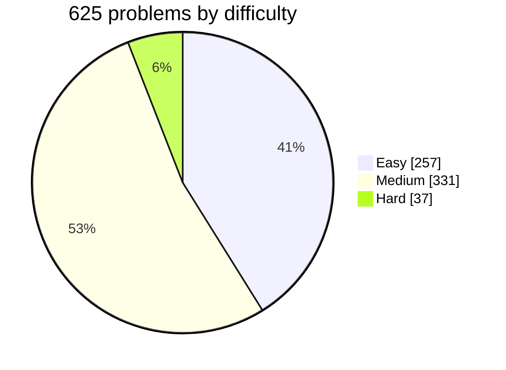
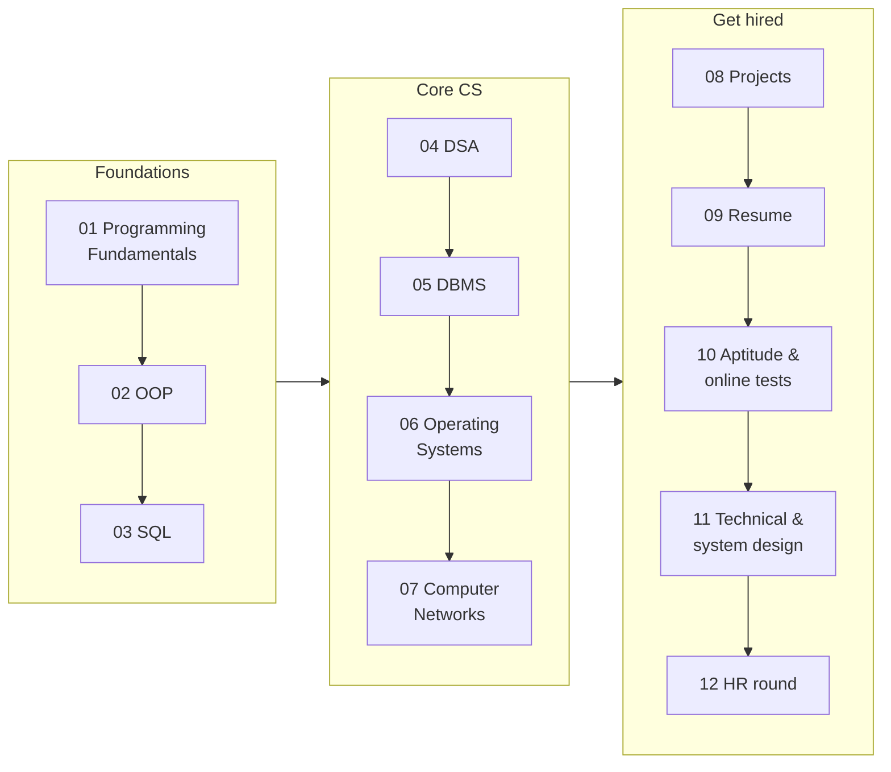
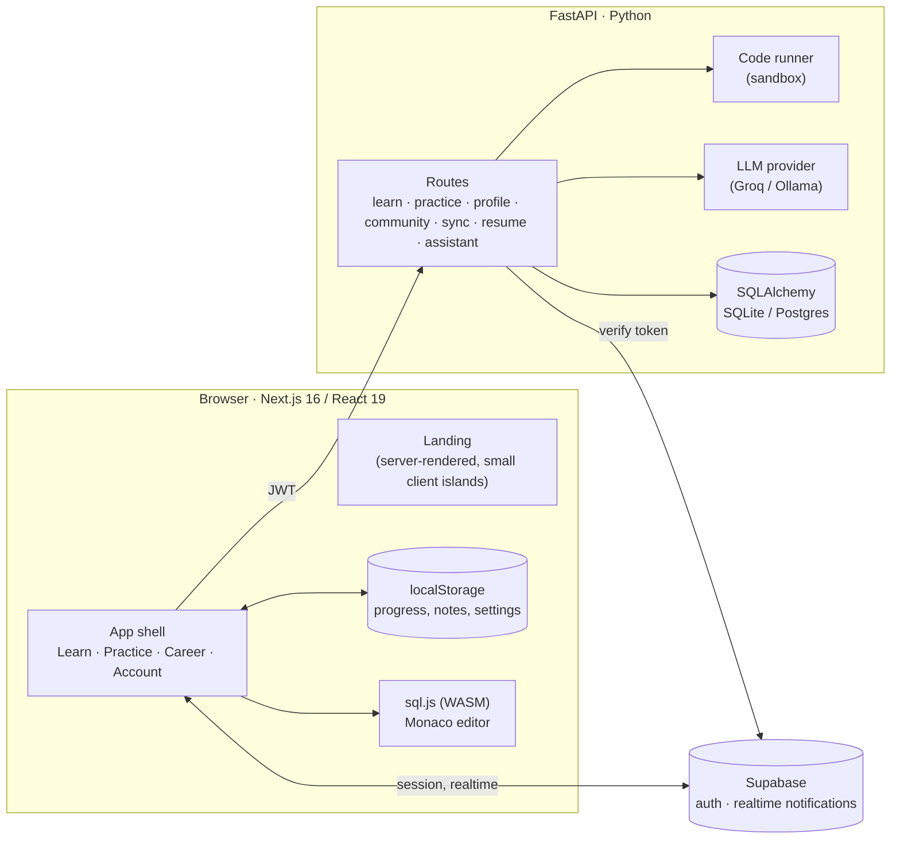

<div align="center">


<br/>

**Placement prep for engineering students: the hiring rounds at each company, the subjects those rounds test, the order to learn them in, and practice on the same kind of questions.**

<br/>


<br/>


<br/>

<a href="https://studyhub-woad-three.vercel.app"></a>

<br/><br/>

[**What's inside**](#whats-inside) · [**Pick a company**](#pick-a-company) · [**Your plan**](#your-plan-week-by-week) · [**How it works**](#how-it-works) · [**Architecture**](#architecture) · [**Run it locally**](#run-it-locally)

</div>

<br/>

## By the numbers

Every figure below is counted from the content in this repository, not typed in.

<div align="center">

| 13 | 402 | 1,576 | 625 | 12 | 8 | 10 | 5 |
|:--:|:--:|:--:|:--:|:--:|:--:|:--:|:--:|
| **courses** | **lessons** | **quiz questions** | **coding problems** | **roadmap stages** | **company playbooks** | **browser tools** | **interactive labs** |

</div>

## What's inside

<table>
<tr>
<td width="50%" valign="top">

### 📖 Learn
13 courses (DSA, OOP, SQL, DBMS, OS, networks, system design, aptitude…) with long-form theory, worked examples and a quick check after each section.
- **Reading bar** on every lesson: solid rust shows where you are, pale rust the furthest you've read. That point is saved as the lesson's progress, so *Continue* takes you back to the paragraph you left, on any device.
- **Asked-in tags**: each lesson shows the companies reported to test that subject.
- Mock tests per subject, a revision sheet, a reading order, and a knowledge map.

</td>
<td width="50%" valign="top">

### 🧩 Practice
- **625 coding problems** in 20 pattern groups, with an in-browser Monaco editor, hints, and code run against visible and hidden tests in a sandbox.
- **394 of them carry company tags** from real interview reports, most-reported first.
- **SQL lab** running SQLite in the browser (sql.js / WebAssembly) on seeded tables.
- **Review queue**: every missed question comes back on a Leitner schedule (1, 3, 7, 14, 30 days) until it sticks.

</td>
</tr>
<tr>
<td width="50%" valign="top">

### 🏢 Prepare for a company
- 8 company playbooks: the rounds in order, the topics that come up, and which StudyHub modules to study first.
- A **week-by-week planner**: pick a company and the months you have left, get the modules it tests spread over your weeks.
- Target companies saved to your profile, and a Company prep tool that builds a plan from them.

</td>
<td width="50%" valign="top">

### 🛠️ Tools, labs and AI
Resume analyser, interview simulator, STAR builder, DSA visualiser, SQL playground, aptitude timer, CGPA converter, readiness calculator, tech-question drills and company prep, plus 5 labs (CPU scheduling, page replacement, subnetting, Big-O, capacity estimation).
An **AI study assistant** answers from the course content and gives hints rather than full solutions.

</td>
</tr>
</table>

<details>
<summary><b>More: accounts, sync, community and the small things that make it feel finished</b></summary>

<br/>

- **Real accounts**: Supabase auth, password change that re-checks the current password, and full account deletion (`DELETE /api/profile` removes the login and every row the user owns).
- **Cross-device sync**: lesson progress, notes, bookmarks, test history and settings sync through the API with last-write-wins per key.
- **Submissions history**: every run and submit is kept, with an activity heatmap on your profile.
- **Notifications**: a realtime bell backed by a Supabase table with row-level security.
- **Community** board: questions, discussions, wins and resources with upvotes, replies, @-mentions and daily study logs.
- **Themes**: Paper and Dark, chosen before first paint (no flash), plus an in-app *Reduce motion* switch.
- **Accessibility**: skip link, every control reachable by keyboard, accessible names on every button and link, AA contrast, reduced-motion support.

</details>

## Pick a company

The same data the landing page and the Companies page use: each company's rounds, and the problems in our set it is most often reported to ask. Open one.

<details>
<summary><b>Amazon</b> · Product MNC · 260 problems reported</summary>

| Rounds | Most reported in our set |
|---|---|
| 1. OA: coding + survey<br/>2–3. DSA + object design<br/>4. Bar raiser round | Two Sum · *Easy*<br/>Trapping Rain Water · *Hard*<br/>Number of Islands · *Medium* |

</details>

<details>
<summary><b>Google</b> · Product MNC · 246 problems reported</summary>

| Rounds | Most reported in our set |
|---|---|
| 1. OA, hard difficulty<br/>2–3. 45-minute technical rounds<br/>4. Behavioural and culture fit | Two Sum · *Easy*<br/>Add Two Numbers · *Medium*<br/>Median of Two Sorted Arrays · *Hard* |

</details>

<details>
<summary><b>Microsoft</b> · Product MNC · 212 problems reported</summary>

| Rounds | Most reported in our set |
|---|---|
| 1. Codility OA, 3 tasks<br/>2. Data structures and LLD<br/>3. Hiring manager round | Two Sum · *Easy*<br/>Add Two Numbers · *Medium*<br/>Longest Substring Without Repeating Characters · *Medium* |

</details>

<details>
<summary><b>TCS Digital / Prime</b> · High-volume IT · 167 problems reported</summary>

| Rounds | Most reported in our set |
|---|---|
| 1. NQT: cognitive and technical<br/>2. Two coding challenges<br/>3. Technical + HR panel | Two Sum · *Easy*<br/>Longest Palindromic Substring · *Medium*<br/>Palindrome Number · *Easy* |

</details>

<details>
<summary><b>Infosys</b> · High-volume IT · 129 problems reported</summary>

| Rounds | Most reported in our set |
|---|---|
| 1. Online screening round<br/>2. Algorithmic puzzles<br/>3. Technical deep-dive | Two Sum · *Easy*<br/>Longest Substring Without Repeating Characters · *Medium*<br/>Best Time to Buy and Sell Stock · *Easy* |

</details>

<details>
<summary><b>Zoho Corp</b> · Product MNC · 103 problems reported</summary>

| Rounds | Most reported in our set |
|---|---|
| 1. C flowcharts and pointers<br/>2. Written coding test<br/>3. Application design | Longest Substring Without Repeating Characters · *Medium*<br/>Spiral Matrix · *Medium*<br/>Two Sum · *Easy* |

</details>

<details>
<summary><b>Accenture</b> · High-volume IT · 66 problems reported</summary>

| Rounds | Most reported in our set |
|---|---|
| 1. Cognitive assessment<br/>2. Technical and pseudocode<br/>3. Coding + interview | Two Sum · *Easy*<br/>Best Time to Buy and Sell Stock · *Easy*<br/>Subarray Sum Equals K · *Medium* |

</details>

<details>
<summary><b>Deloitte USI</b> · FinTech and consulting · 26 problems reported</summary>

| Rounds | Most reported in our set |
|---|---|
| 1. Aptitude and English test<br/>2. Technical assessment<br/>3. Case study and HR | Two Sum · *Easy*<br/>Longest Substring Without Repeating Characters · *Medium*<br/>Valid Parentheses · *Easy* |

</details>

<sub>Rounds come from companies' prep pages, public prep guides and candidate reports; problem tags come from public interview reports. Formats change by year, role and campus, so check your own assessment notice.</sub>

## Your plan, week by week

What the planner on the landing page builds for **Amazon with 3 months left**: the modules Amazon is reported to test, in roadmap order, sized by each lesson's time estimate (18 modules, 71 lessons, about 28 hours of reading). The last week is kept for timed mocks.

| Week | Modules | Subject | Lessons | Reading |
|:--:|---|---|:--:|:--:|
| 1 | DSA Fundamentals | DSA | 4 | 1h 20m |
| 2 | Arrays + Strings | DSA | 9 | 3h 45m |
| 3 | Linked List | DSA | 4 | 1h 15m |
| 4 | Stack + Queue | DSA | 7 | 2h 10m |
| 5 | Hashing + Trees | DSA | 7 | 2h 45m |
| 6 | Heaps / Priority Queues | DSA | 3 | 1h 10m |
| 7 | Graphs + Recursion & Backtracking | DSA | 8 | 3h 30m |
| 8 | Dynamic Programming + Design Foundations | DSA → System design | 9 | 3h 45m |
| 9 | Networking Building Blocks | System design | 3 | 1h |
| 10 | Data Storage and Caching + Async Processing and Reliability | System design | 7 | 2h 40m |
| 11 | Design Walkthroughs (both parts) | System design | 10 | 4h 55m |
| 12 | **Timed mock tests and your review queue** | All | | |

<sub>Generated by the same allocation code the landing page runs (<code>frontend/components/landing/plan.ts</code>). Practice problems and quizzes come on top of the reading time.</sub>

## The practice set

625 problems, every one with tests. Grouped the way rounds test them, so you can work one pattern at a time.



<details>
<summary><b>All 20 pattern groups</b></summary>

<br/>

| Pattern | Problems | Pattern | Problems |
|---|:--:|---|:--:|
| Dynamic Programming | 37 | Matrix | 31 |
| Graphs | 34 | Greedy | 31 |
| Bit Manipulation | 32 | Hashing | 30 |
| Trees | 32 | Arrays | 30 |
| Backtracking | 32 | Prefix Sum | 30 |
| Linked List | 31 | Sorting | 30 |
| Sliding Window | 31 | Recursion | 30 |
| Binary Search | 31 | Heap | 30 |
| Two Pointers | 31 | Basics | 30 |
| Stack & Queue | 31 | Strings | 31 |

Topic-wise problems are generated with tested expected outputs by `frontend/scripts/build-core-problems.py`; company tags are joined in by `frontend/scripts/import-company-data.py`.

</details>

## How it works



1. **Pick the role you want.** The Software Engineer track is ready today. AI/ML, data engineering, cloud, data analyst and security tracks are planned and will share the same core CS stages.
2. **Learn the stages in order.** Twelve roadmap stages from programming basics to the HR round, each with notes, a sample interview question and the companies that test it.
3. **Practice what the rounds test.** Problems, quizzes, mock tests and labs, with everything you miss fed back through the review queue.

<details>
<summary><b>Progress log</b></summary>

<br/>

| Milestone | What landed |
|---|---|
| **Landing rebuild** | Problem and outcome sections, a week-by-week planner, a "most reported" panel in the hero and a day-one dashboard preview, all from real data |
| **Real interview data** | Company tags on problems, asked-in tags on lessons, page guides |
| **Paths and community** | Expanded learning paths and the Community board |
| **AI and practice** | AI assistant, the 625-problem set, submissions history and real resume analysis |
| **Sandboxed runners** | Code runs in a sandbox, plus a practice ladder of warm-ups |
| **Paper & Ink** | Full UI rebuild on the design system, real reading progress, account actions, cross-device sync |

</details>

## Architecture



| Layer | What it uses |
|---|---|
| **Frontend** | Next.js 16 (App Router, Turbopack), React 19, TypeScript, Tailwind CSS 4 with design tokens, `next/font`, lucide-react, Monaco, sql.js |
| **Backend** | FastAPI, SQLAlchemy (async), Alembic migrations, Pydantic, pytest |
| **Auth and realtime** | Supabase (email auth, JWT verification with a local JWKS fallback, realtime notifications with RLS) |
| **AI** | Pluggable LLM provider (Groq or Ollama) for the study assistant, resume analysis and interview feedback; keys stay on the backend |
| **Code execution** | Sandboxed runs against hidden tests |

## Run it locally

<details open>
<summary><b>1. Backend (FastAPI)</b></summary>

```bash
cd backend
python -m venv venv
# Windows: .\venv\Scripts\Activate.ps1    macOS/Linux: source venv/bin/activate
pip install -r requirements.txt
cp .env.example .env            # add your Supabase keys, DATABASE_URL and GROQ_API_KEY (or OLLAMA_*)
python scripts/seed_data.py
uvicorn app.main:app --reload --port 8000
```

</details>

<details open>
<summary><b>2. Frontend (Next.js)</b></summary>

```bash
cd frontend
npm install
cp .env.example .env.local      # NEXT_PUBLIC_API_URL, NEXT_PUBLIC_SUPABASE_URL, NEXT_PUBLIC_SUPABASE_ANON_KEY
npm run dev                     # http://localhost:3000
```

</details>

<details>
<summary><b>3. Checks</b></summary>

```bash
# frontend
npm run lint                    # ESLint: 0 problems
npm run build                   # production build
npx tsx scripts/check-study.ts  # content and logic checks (also check-sync, check-labs, check-daily, check-asked-in, …)

# backend
cd backend && python -m pytest  # 42 passing, 6 skipped
```

The Supabase `notifications` table is defined in [`backend/supabase/notifications.sql`](backend/supabase/notifications.sql).

</details>

## Design system

StudyHub uses **Paper & Ink**, a neo-brutalist editorial system shared with the author's portfolio: cream paper, ink type, one rust accent, thick ink borders with hard offset shadows, Anton headlines, Barlow Condensed labels and Inter body text. Tokens live in [`frontend/app/globals.css`](frontend/app/globals.css); the rules are in [`DESIGN.md`](DESIGN.md), and the logo brief is in [`docs/LOGO_PROMPT.md`](docs/LOGO_PROMPT.md).

<details>
<summary><b>Project structure</b></summary>

```text
StudyHub/
├── frontend/
│   ├── app/                 # routes: landing, learn, practice, companies, tools, labs, community, profile, settings…
│   ├── components/          # ui primitives, layout shell, landing islands, feature components
│   ├── lib/                 # course content, problem registry, company data, services, sync, theme
│   └── scripts/             # content checks (tsx) and data importers (Python)
├── backend/
│   ├── app/                 # FastAPI routes, models, schemas, services, AI provider
│   ├── migrations/          # Alembic
│   ├── scripts/             # seeders
│   ├── supabase/            # SQL for Supabase-side tables
│   └── tests/               # pytest
├── docs/                    # plans, logo brief, README banner
└── DESIGN.md                # Paper & Ink design system
```

</details>

<div align="center">
<br/>

<br/>
<sub>Built by <a href="https://www.vamsee.tech/">Vamsee</a> · StudyHub</sub>
</div>
