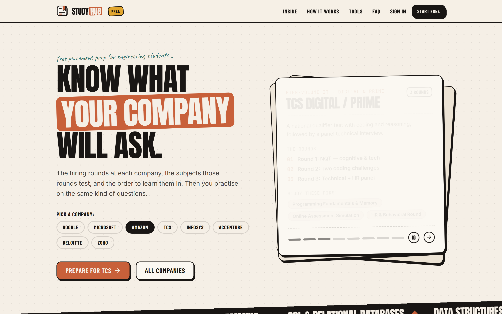
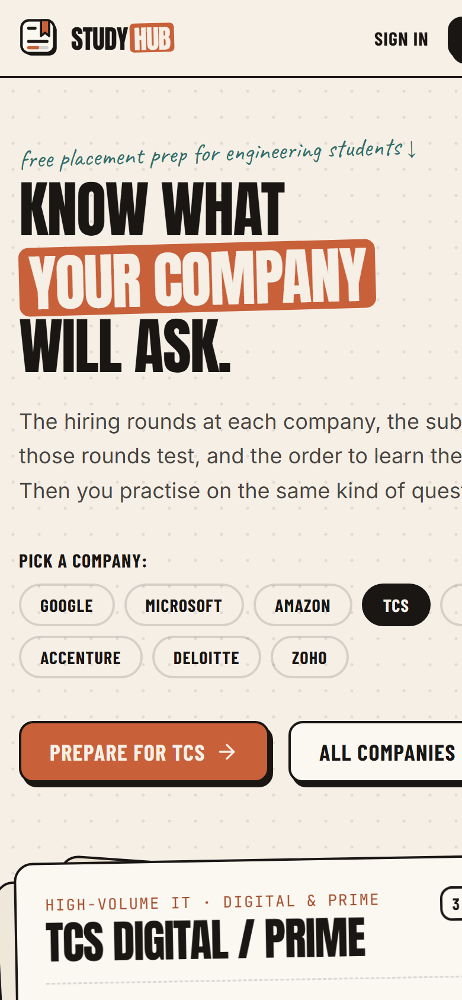
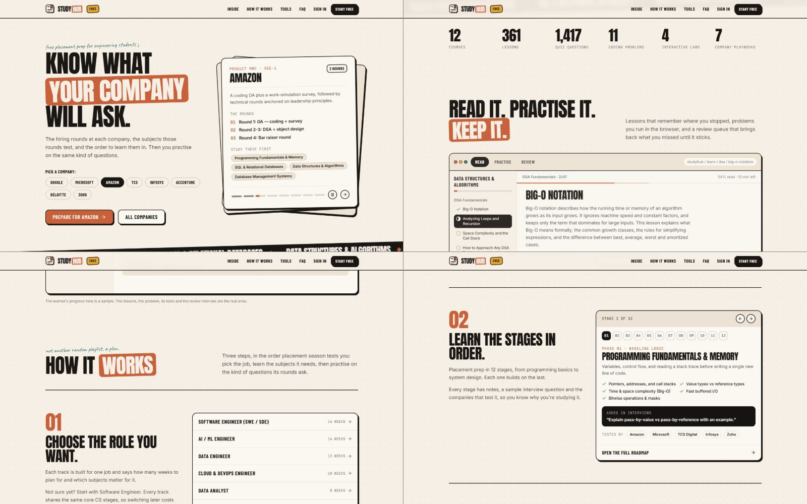
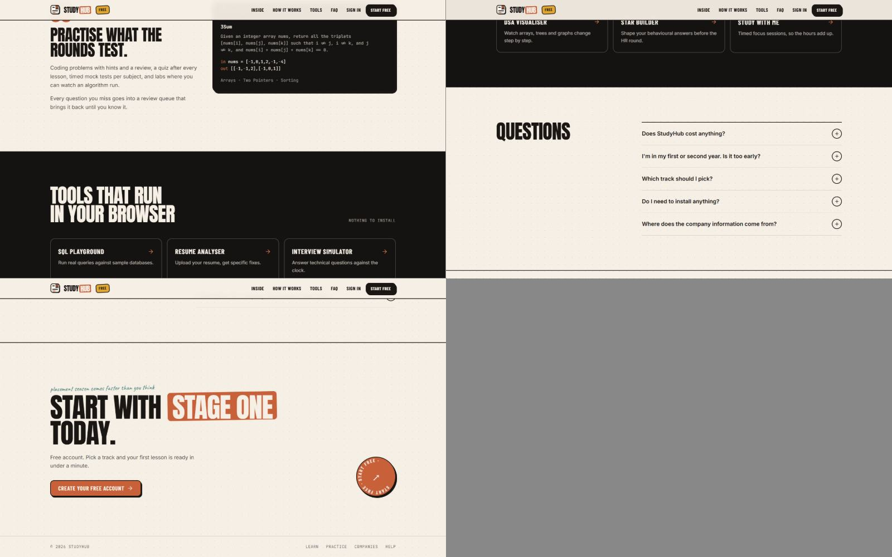
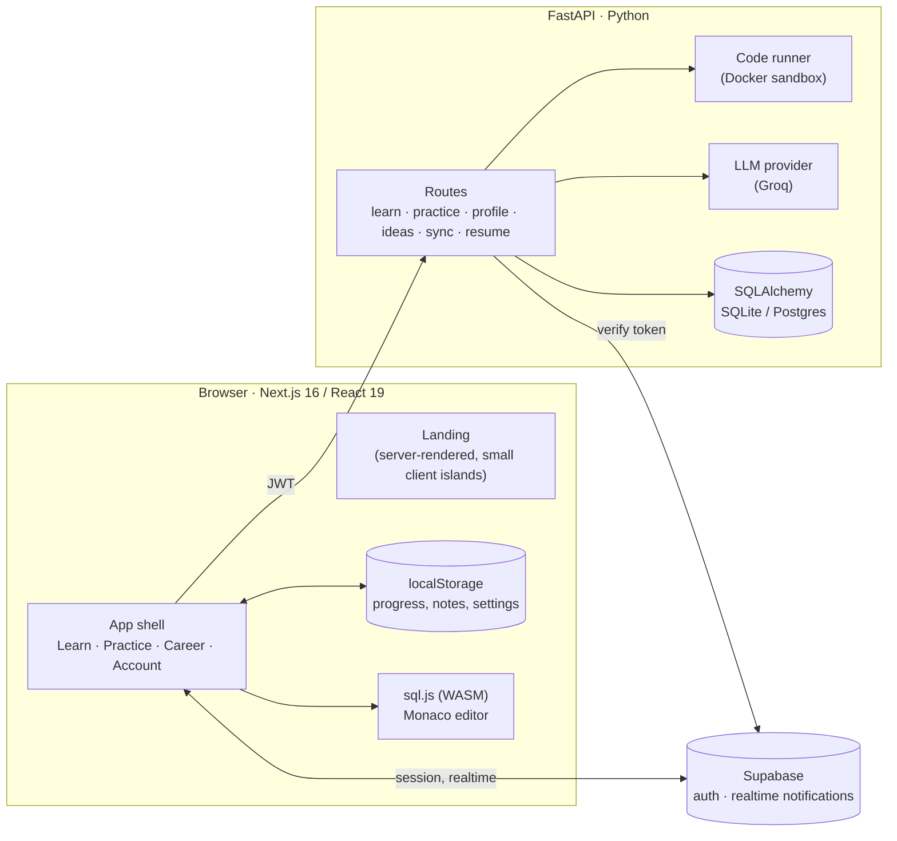

<div align="center">



<br/>

**Placement prep for engineering students: the hiring rounds at each company, the subjects those rounds test, the order to learn them in, and practice on the same kind of questions.**

<br/>


<br/>


[**What's inside**](#whats-inside) · [**How it works**](#how-it-works) · [**Architecture**](#architecture) · [**Run it locally**](#run-it-locally) · [**Design system**](#design-system)

</div>

<br/>

<table>
<tr>
<td width="68%"></td>
<td width="32%"></td>
</tr>
</table>

## By the numbers

Every figure below is counted from the content in this repository at build time, not typed in.

<div align="center">

| 13 | 402 | 1,576 | 12 | 5 | 8 | 10 |
|:--:|:--:|:--:|:--:|:--:|:--:|:--:|
| **courses** | **lessons** | **quiz questions** | **coding problems** | **interactive labs** | **company playbooks** | **browser tools** |

</div>

## What's inside

<table>
<tr>
<td width="50%" valign="top">

### 📖 Learn
13 courses (DSA, OOP, SQL, DBMS, OS, networks, system design, aptitude…) with long-form theory, worked examples and a quick check after each section.
- **Reading bar** on every lesson: solid rust shows where you are, pale rust the furthest you've read. That point is saved as the lesson's progress, so *Continue* takes you back to the paragraph you left, on any device.
- Mock tests per subject, a revision sheet, a reading order, and a knowledge map.

</td>
<td width="50%" valign="top">

### 🧩 Practice
- **Problem set** with an in-browser Monaco editor, hints, and code run against visible and hidden tests.
- **SQL lab** running SQLite in the browser (sql.js / WebAssembly) on seeded tables.
- **Review queue**: every missed question comes back on a Leitner schedule (1, 3, 7, 14, 30 days) until it sticks.

</td>
</tr>
<tr>
<td width="50%" valign="top">

### 🏢 Prepare for a company
- 8 company playbooks: the rounds in order, the topics that come up, and which StudyHub modules to study first.
- Target companies saved to your profile, and a Company prep tool that builds a plan from them.

</td>
<td width="50%" valign="top">

### 🛠️ Tools and labs
Resume analyser, interview simulator, STAR builder, DSA visualiser, SQL playground, aptitude timer, CGPA converter, readiness calculator, tech-question drills plus 5 OS / networking / systems labs (CPU scheduling, page replacement, subnetting, Big-O, capacity estimation).

</td>
</tr>
</table>

<details>
<summary><b>More: accounts, sync and the small things that make it feel finished</b></summary>

<br/>

- **Real accounts**: Supabase auth, password change that re-checks the current password, and full account deletion (`DELETE /api/profile` removes the login and every row the user owns).
- **Cross-device sync**: lesson progress, notes, bookmarks, test history and settings sync through the API with last-write-wins per key.
- **Notifications**: a realtime bell backed by a Supabase table with row-level security.
- **Community** board: questions, discussions, wins and resources with upvotes, replies, @-mentions and daily study logs.
- **Themes**: Paper and Dark, chosen before first paint (no flash), plus an in-app *Reduce motion* switch.
- **Accessibility**: skip link, every control reachable by keyboard, accessible names on every button and link, AA contrast, reduced-motion support.

</details>

## How it works



1. **Pick the role you want.** Six tracks (SWE, AI/ML, data, cloud, analyst, security), each with how many weeks to plan and which subjects matter.
2. **Learn the stages in order.** Twelve roadmap stages from programming basics to system design, each with notes, a sample interview question and the companies that test it.
3. **Practice what the rounds test.** Problems, quizzes, mock tests and labs, with everything you miss fed back through the review queue.



## Architecture



| Layer | What it uses |
|---|---|
| **Frontend** | Next.js 16 (App Router, Turbopack), React 19, TypeScript, Tailwind CSS 4 with design tokens, `next/font`, lucide-react, Monaco, sql.js |
| **Backend** | FastAPI, SQLAlchemy (async), Alembic migrations, Pydantic, pytest |
| **Auth and realtime** | Supabase (email auth, JWT verification with a local JWKS fallback, realtime notifications with RLS) |
| **AI** | Pluggable LLM provider (Groq) for the tutor, resume analysis and interview feedback |
| **Code execution** | Sandboxed runs against hidden tests (Docker) |

## Run it locally

<details open>
<summary><b>1. Backend (FastAPI)</b></summary>

```bash
cd backend
python -m venv venv
# Windows: .\venv\Scripts\Activate.ps1    macOS/Linux: source venv/bin/activate
pip install -r requirements.txt
cp .env.example .env            # add your Supabase keys, DATABASE_URL and GROQ_API_KEY
python scripts/seed_data.py
uvicorn app.main:app --reload --port 8000
```

</details>

<details open>
<summary><b>2. Frontend (Next.js)</b></summary>

```bash
cd frontend
npm install
cp .env.example .env.local      # NEXT_PUBLIC_API_URL, NEXT_PUBLIC_SUPABASE_URL, NEXT_PUBLIC_SUPABASE_ANON_KEY
npm run dev                     # http://localhost:3000
```

</details>

<details>
<summary><b>3. Checks</b></summary>

```bash
# frontend
npm run lint                    # ESLint: 0 errors, 0 warnings
npm run build                   # production build
npx tsx scripts/check-study.ts  # content and logic checks (also check-sync, check-labs, check-daily, …)

# backend
cd backend && python -m pytest  # 31 tests
```

The Supabase `notifications` table is defined in [`backend/supabase/notifications.sql`](backend/supabase/notifications.sql).

</details>

## Design system

StudyHub uses **Paper & Ink**, a neo-brutalist editorial system shared with the author's portfolio: cream paper, ink type, one rust accent, thick ink borders with hard offset shadows, Anton headlines, Barlow Condensed labels and Inter body text. Tokens live in [`frontend/app/globals.css`](frontend/app/globals.css); the rules are in [`DESIGN.md`](DESIGN.md), and the logo brief is in [`docs/LOGO_PROMPT.md`](docs/LOGO_PROMPT.md).

<details>
<summary><b>Project structure</b></summary>

```text
StudyHub/
├── frontend/
│   ├── app/                 # routes: landing, learn, practice, companies, tools, labs, profile, settings…
│   ├── components/          # ui primitives, layout shell, landing islands, feature components
│   ├── lib/                 # course content, problem registry, services, sync, theme
│   └── scripts/             # content and logic checks (tsx)
├── backend/
│   ├── app/                 # FastAPI routes, models, schemas, services, AI provider
│   ├── migrations/          # Alembic
│   ├── scripts/             # seeders
│   ├── supabase/            # SQL for Supabase-side tables
│   └── tests/               # pytest
├── docs/                    # plans, logo brief, README images
└── DESIGN.md                # Paper & Ink design system
```

</details>

<div align="center">
<br/>

<br/>
<sub>Built by <a href="https://www.vamsee.tech/">Vamsee</a> · StudyHub</sub>
</div>
